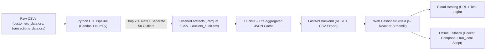

# วิเคราะห์โจทย์แข่งขันทักษะการวิเคราะห์ข้อมูล (ปวช.) ระดับจังหวัด — SmartRetail Thailand

> เอกสารฉบับนี้วิเคราะห์จากโจทย์แข่งขัน [`โจทย์แข่งขัน_ทักษะการวิเคราะห์ข้อมูล_ปวช_ระดับจังหวัด.docx`](โจทย์แข่งขัน_ทักษะการวิเคราะห์ข้อมูล_ปวช_ระดับจังหวัด.docx) ร่วมกับผลตรวจสอบและ Profiling ข้อมูลจริงใน [`customers_data.csv`](customers_data.csv) และ [`transactions_data.csv`](transactions_data.csv) เพื่อใช้เป็นพิมพ์เขียวในการพัฒนา Pipeline, Web Dashboard, Infographic และสไลด์นำเสนอให้ได้ระดับเหรียญทอง ($\ge 80$ คะแนน)

---

## 1. ภาพรวมโจทย์และการแข่งขัน (Competition Overview)

- **หัวข้อ**: การวิเคราะห์พฤติกรรมลูกค้าและประสิทธิภาพยอดขายของธุรกิจค้าปลีกอุปโภคบริโภค (**SmartRetail Thailand**)
- **ปัญหาทางธุรกิจ (Business Problem)**: บริษัทจำหน่ายสินค้าอุปโภคบริโภคทั้งช่องทาง **หน้าร้าน (In-Store)** และ **ออนไลน์ (Online)** กำลังประสบปัญหายอดขายเติบโตลดลง/ชะลอตัว ต้องการ Data Analyst ช่วยสกัด Insight เชิงธุรกิจและข้อเสนอแนะเชิงปฏิบัติจากข้อมูลดิบ
- **ภารกิจหลัก 5 ด้าน**:
  1. **Data Preparation**: ตรวจ Schema/Data Types, เชื่อมโยง PK/FK (`Customer_ID`, เกณฑ์ $\text{FK Match} \ge 99\%$), ทำความสะอาด Missing Values & Outliers, จัดทำ Data Dictionary และ Pipeline ที่ทำซ้ำได้
  2. **Exploratory Data Analysis (EDA)**: สถิติเชิงพรรณนา (`Mean`, `Median`, `Std`, `IQR`), แนวโน้มตามเวลา (`Time Series`), ความสัมพันธ์ (`Correlation`), และการเปรียบเทียบข้ามกลุ่ม (`Channel`, `Category`, `Region`, `Membership_Tier`)
  3. **Visualization & Web System**: ออกแบบ Dashboard/Web Interface (`Overview -> Detail`), มี Filter, แสดงสถานะระบบ, Export ข้อมูลได้ และรองรับทั้งเวอร์ชันออนไลน์และติดตั้งบนเครื่องสำรอง
  4. **Deliverables**: เว็บนำเสนอข้อมูล, Infographic User Manual, สไลด์นำเสนอ, และ Cleaned Dataset + Script/Notebook
  5. **Presentation & Q&A**: นำเสนอ 10 นาที + ตอบคำถามเชิงเทคนิคและ Insight ต่อคณะกรรมการ

### เกณฑ์เหรียญรางวัลและสิ่งที่ต้องส่งมอบ (Deliverables Checklist)

| ระดับรางวัล | เกณฑ์คะแนน | เป้าหมายเชิงกลยุทธ์ |
| :--- | :---: | :--- |
| **เหรียญทอง (Gold)** | $\ge 80$ | เก็บหมวดหลัก 1–3 และ 7 ให้ได้ $\ge 85\%$ ของคะแนนเต็ม และไม่ตกหล่นหมวด UX/Deploy/Performance |
| **เหรียญเงิน (Silver)** | $70 - 79$ | — |
| **เหรียญทองแดง (Bronze)** | $60 - 69$ | — |

- [ ] **1. Data Visualization Web Interface / Dashboard**: URL ออนไลน์พร้อมบัญชีทดสอบ + เวอร์ชันติดตั้งสำรองบนเครื่อง
- [ ] **2. Infographic User Manual**: อินโฟกราฟิกสรุปวิธีใช้งานระบบและแนวคิดการวิเคราะห์ข้อมูล
- [ ] **3. Presentation Slide**: สไลด์โครงเรื่อง 4 ช่วง (`Problem -> Method -> Findings -> Recommendations`)
- [ ] **4. Data Cleaning Steps & Cleaned Dataset**: ไฟล์ Cleaned CSV/Parquet + Script/Notebook ที่รันซ้ำได้

---

## 2. วิเคราะห์เกณฑ์คะแนน Rubric 100 คะแนน และกลยุทธ์พิชิตเหรียญทอง

น้ำหนักคะแนน **76% อยู่ที่ 4 หมวดหลัก** (หมวด 1, 2, 3 และ 7) ส่วนอีก **24%** อยู่ที่ UX/UI, Deployment, Performance และการนำเสนอ:

| หมวดการประเมิน | เต็ม | เป้าเหรียญทอง | จุดชี้ขาดคะแนน (High-Leverage Actions) |
| :--- | :---: | :---: | :--- |
| **1. การเตรียมและจัดการข้อมูล** | **18** | 16–18 | • พิสูจน์ $\text{FK Match Rate} = 100\%$ (`1,000/1,000` ลูกค้า)<br>• ใช้ทั้ง **IQR และ Z-Score** พิสูจน์ Outliers + เปรียบเทียบ Before/After<br>• ส่งออก `cleaned_transactions.csv` / `.parquet`, `outliers_audit.csv`, และ Data Dictionary |
| **2. การสำรวจข้อมูล (EDA)** | **18** | 16–18 | • ครบทุกสถิติ (`Mean`, `Median`, `Std`, `IQR`) ทั้งก่อนและหลัง clean<br>• แสดง Time Series รายเดือน/ไตรมาส + Correlation Heatmap<br>• สรุป **Business Insights 3–5 ข้อ** พร้อมตัวเลขอ้างอิงจริงทุกข้อ |
| **3. การสื่อสารด้วยกราฟ/ตาราง** | **20** | 17–19 | • เลือกกราฟตรงชนิดข้อมูล (Line = เวลา, Bar/Treemap = เปรียบเทียบ, Heatmap = Correlation, Boxplot = กระจายตัว)<br>• เขียนคำอธิบายใต้ทุกกราฟตามสูตร **`What -> So What -> Now What`**<br>• ตัวเลขในกราฟ ตาราง และสไลด์ต้องตรงกัน 100% |
| **4. การใช้งานระบบ (UX/UI)** | **6** | 5–6 | • นำทางแบบ `Overview -> Detail` หาคำตอบได้ใน **$\le 3\text{--}4$ คลิก**<br>• มี **Loading State (Skeleton), Empty State, Error Boundary**<br>• ผ่านเกณฑ์ Accessibility (Font $\ge 14\text{--}16\text{px}$, Contrast ชัดเจน) |
| **5. การติดตั้งและใช้งานจริง** | **3** | 3 | • Deploy ออนไลน์พร้อมบัญชีทดสอบที่ล็อกอินได้ทันที<br>• มี `Dockerfile` / `docker-compose.yml` และสคริปต์รันบนเครื่อง (`run_local.bat` / `run_local.ps1`) |
| **6. ประสิทธิภาพ (Performance)** | **5** | 4–5 | • Pre-aggregate / Cache ข้อมูลด้วย DuckDB หรือ Parquet ไม่คำนวณ raw CSV 50,000 แถวซ้ำทุกคลิก Filter<br>• แสดงเอกสาร/แผนภาพออกแบบสถาปัตยกรรมที่อธิบายเหตุผลด้านความเร็ว |
| **7. สรุปสาระสำคัญผ่านสไลด์** | **20** | 17–19 | • โครงเรื่อง 4 ช่วง: `Problem -> Method -> Findings -> Recommendations`<br>• กฎ **1 สไลด์ ต่อ 1 ประเด็นหลัก** พร้อมอ้างอิงกลับไปยังหน้า Dashboard/ไฟล์จริง<br>• ข้อเสนอแนะระบุ **Action + Owner (ผู้รับผิดชอบ) + Timeline (กรอบเวลา) + KPI เป้าหมาย** |
| **8. การนำเสนอและตอบคำถาม** | **10** | 8–9 | • ซ้อมจับเวลา 10 นาที (Problem 1.5m / Method 2m / Findings 3.5m / Recs 2m / Buffer 1m)<br>• เตรียมคำตอบ Q&A: เหตุผลการตัด Outliers 50 แถว vs Drop Missing 750 แถว |
| **รวม** | **100** | **86–94** | **เป้าหมายปลอดภัยเหนือเกณฑ์เหรียญทอง ($\ge 80$) อย่างน้อย +6 ถึง +14 คะแนน** |

---

## 3. การตรวจสอบและโปรไฟล์ข้อมูลจริงใน `C:\W-AI`

> [!IMPORTANT]
> **ข้อค้นพบสำคัญของไฟล์จริง**: ตารางในเอกสารโจทย์เป็นเพียงตัวอย่าง 15 แถว (`TXN-1001`–`TXN-1015`) แต่ชุดข้อมูลจริงใน `C:\W-AI` มีขนาดใหญ่กว่ามาก ได้แก่ **`customers_data.csv` จำนวน 1,000 แถว** และ **`transactions_data.csv` จำนวน 50,000 แถว** (ช่วงวันที่ `2025-01-01` ถึง `2025-12-31`)

### 3.1 ความสมบูรณ์ของโครงสร้างและ Integrity
- **Primary Key (`Transaction_ID`)**: ไม่ซ้ำกัน `50,000 / 50,000` แถว (`100%`) และ `Customer_ID` ในตารางลูกค้าไม่ซ้ำกัน `1,000 / 1,000` แถว (`100%`)
- **Foreign Key Integrity**: `Customer_ID` ใน `transactions_data.csv` เชื่อมโยงตรงกับ `customers_data.csv` ครบ **100% (`0` orphan rows)** — ผ่านเกณฑ์ $\ge 99\%$
- **Data Formatting & Consistency**:
  - `Transaction_Date`: รูปแบบ `YYYY-MM-DD` ถูกต้องทั้งหมด (`0` bad formats) ครอบคลุมทั้งปี `2025-01-01` ถึง `2025-12-31`
  - `Signup_Date`: `2023-01-01` ถึง `2024-12-31` (ก่อนวันเริ่มธุรกรรมทั้งหมด ไม่มี anomaly สมัครหลังซื้อ)
  - `Price_Per_Unit` ผูก 1-ต่อ-1 กับ `Category` อย่างสม่ำเสมอ (`Snacks = 35`, `Beverages = 45`, `Dry Food = 120`, `Personal Care = 250`, `Household = 890` บาท)
  - `Total_Amount == Units_Sold * Price_Per_Unit` ถูกต้อง `100%` ในทุกแถวที่ไม่เป็น Missing (`0` mismatch rows)

### 3.2 ปัญหาคุณภาพข้อมูลที่ตรวจพบ (Data Quality Issues)
1. **Missing Values (`750` แถว = `1.50%`)**:
   - ทุกแถวที่ Missing ขาดข้อมูล **ทั้ง `Units_Sold` และ `Total_Amount` พร้อมกัน** (`750` แถว, ไม่มีแถวที่ขาดเพียงคอลัมน์เดียว)
   - กระจายตามหมวดหมู่: `Dry Food` (199), `Beverages` (172), `Personal Care` (164), `Household` (111), `Snacks` (104)
   - `customers_data.csv` ไม่มีค่า Missing เลย (`0` แถว)
2. **Extreme Outliers (`50` แถว = `0.10%`)**:
   - เมื่อคำนวณด้วย **IQR Method** บน `Units_Sold` (`n = 49,250` แถวที่ไม่เป็น NaN):
     - $Q_1 = 6.0$, $\text{Median} = 13.0$, $Q_3 = 19.0$, $\text{IQR} = 13.0$
     - เกณฑ์ Upper Fence ($Q_3 + 1.5 \times \text{IQR}$) $= 19.0 + 19.5 = \mathbf{38.5}$ ชิ้น
   - เมื่อคำนวณด้วย **Z-Score Method** ($\text{Mean} = 13.75$, $\text{Std} = 40.57$, เกณฑ์ $|Z| > 3$ คือ $> 135.45$ ชิ้น):
     - **ทั้ง IQR และ Z-Score จับกลุ่ม Outlier ได้ตรงกันพอดีเป๊ะที่ `50` แถว**
   - ค่าที่พบใน 50 แถวนี้มีเพียง 3 ค่าผิดปกติชัดเจนคือ **`999` ชิ้น (16 แถว), `1,200` ชิ้น (15 แถว), และ `1,500` ชิ้น (19 แถว)** ขณะที่ข้อมูลปกติอีก `49,200` แถวอยู่ในช่วง **`1` ถึง `24` ชิ้น** เท่านั้น
   - แม้มีเพียง `0.10%` ของจำนวนรายการ แต่ Outliers 50 แถวนี้สร้างยอดขายเทียมสูงถึง **`14,541,495` บาท (`9.28%` ของยอดขายดิบ `156,698,000` บาท)** และทำให้ค่าเบี่ยงเบนมาตรฐาน (Std) ของ `Total_Amount` พุ่งสูงเกินจริงกว่า **3.5 เท่า**

### 3.3 นโยบาย Data Cleaning ที่แนะนำ (Drop Dual-NaN + Separate Audit Log)
1. **Drop Missing 750 แถว**: เนื่องจาก `Units_Sold` และ `Total_Amount` หายไปพร้อมกันทั้งคู่ (ไม่มีข้อมูลอ้างอิงให้คำนวณย้อนกลับได้แม่นยำ) และมีสัดส่วนเพียง `1.50%` การตัดออกในชุดหลักจึงรักษาความถูกต้องเชิงบัญชีได้ดีกว่าการ Impute
2. **แยก Outliers 50 แถวออกเป็น `outliers_audit.csv`**: ไม่ลบทิ้งถาวร แต่แยกออกจากการวิเคราะห์พฤติกรรมค้าปลีกปกติ (Main Cleaned Dataset `49,200` แถว) พร้อมส่งมอบไฟล์ Audit Log ให้ฝ่ายปฏิบัติการตรวจสอบว่าเป็น Error การคีย์ข้อมูลหรือคำสั่งซื้อ B2B เหมาล็อต

#### ตารางเปรียบเทียบสถิติเชิงพรรณนา: ก่อน Clean vs หลัง Clean

| ตัวชี้วัด (`Total_Amount`, บาท) | ก่อน Clean (`n = 49,250`) | หลัง Clean (`n = 49,200`) | การเปลี่ยนแปลง / ความหมาย |
| :--- | :---: | :---: | :--- |
| **รวมยอดขาย (Total Revenue)** | `156,698,000` | `142,156,505` | ตัดยอดบิดเบือนจาก Outlier ออก `14,541,495` บาท (`-9.28%`) |
| **Mean (ค่าเฉลี่ย)** | `3,181.69` | `2,889.36` | ลดการดึงค่าเฉลี่ยสูงเกินจริง (`-9.19%`) |
| **Std. Dev. (ส่วนเบี่ยงเบนมาตรฐาน)** | `15,697.61` | `4,399.19` | ความแปรปรวนลดลง **`-71.98%`** สะท้อนพฤติกรรมจริง |
| **Min / Max** | `35.00` / `1,335,000.00` | `35.00` / `21,360.00` | ค่าสูงสุดเหลือระดับปกติ (`24 ชิ้น x 890 บาท`) |
| **Q1 / Median / Q3 (IQR)** | `500` / `1,035` / `2,880` (`2,380`) | `500` / `1,035` / `2,880` (`2,380`) | ค่า Quantile หลักไม่เพี้ยน ยืนยันความเสถียรของข้อมูล |

> สำหรับ `Units_Sold` หลัง Clean (`n = 49,200`): `Mean = 12.50` ชิ้น, `Std = 6.93` ชิ้น, `Min = 1`, `Q1 = 6`, `Median = 13`, `Q3 = 19`, `IQR = 13`, `Max = 24` ชิ้น (รวมทั้งหมด `614,879` ชิ้น)

---

## 4. ผลการวิเคราะห์ EDA เบื้องต้นและ Business Insights (`49,200` Clean Rows)

### 4.1 แนวโน้มยอดขายรายเดือนและรายไตรมาส (Time Series 2025)

| เดือน | Clean Txns | Clean Revenue (บาท) | Raw Revenue (บาท) | Outliers ในเดือน |
| :---: | :---: | :---: | :---: | :---: |
| `2025-01` | 4,263 | 12,330,985 | 12,398,485 | 1 |
| `2025-02` | 3,694 | 10,971,770 | 12,391,985 | 5 |
| `2025-03` | 4,222 | 11,976,710 | 12,539,090 | 3 |
| `2025-04` | 4,090 | 12,246,560 | 12,458,060 | 2 |
| `2025-05` | 4,066 | 11,180,430 | 11,687,265 | 4 |
| `2025-06` | 4,019 | 11,697,635 | **14,931,590** | 5 |
| `2025-07` | 4,170 | 12,208,395 | 13,586,460 | 4 |
| `2025-08` | 4,337 | 12,533,170 | **15,524,005** | 8 |
| `2025-09` | 4,061 | 11,587,820 | 12,240,275 | 4 |
| `2025-10` | 4,159 | 12,063,115 | 13,554,070 | 5 |
| `2025-11` | 3,934 | 11,385,335 | 11,900,300 | 3 |
| `2025-12` | 4,185 | 11,974,580 | 13,486,415 | 6 |

- **สรุปรายไตรมาส (Clean)**: Q1 = `35.28M`, Q2 = `35.12M` (`-0.44%`), Q3 = `36.33M` (`+3.43%`), Q4 = `35.42M` (`-2.49%`) — ยอดขายรวมทั้งปี **ชะลอตัวในกรอบแคบ** (`~11.0M–12.5M` บาท/เดือน) โดย Q4 ใกล้เคียง Q1 (`+0.41%`) สอดคล้องกับโจทย์ที่ระบุว่ายอดขายเติบโตลดลง ขณะที่ข้อมูลดิบทำให้เดือนมิถุนายนและสิงหาคมดูเหมือนมียอดพุ่งผิดปกติจาก Outliers

### 4.2 ความสัมพันธ์ของตัวแปร (Correlation)
- `Corr(Price_Per_Unit, Total_Amount) = +0.8123` (ความสัมพันธ์เชิงบวกสูงมาก: ยอดเงินต่อบิลถูกขับเคลื่อนด้วยราคาสินค้า/หมวดหมู่เป็นหลัก)
- `Corr(Price_Per_Unit, Units_Sold) = -0.0065` (ลูกค้าซื้อเฉลี่ย ~12.5 ชิ้นต่อบิลเท่ากันในทุกหมวดหมู่ ไม่ว่าราคาจะ 35 หรือ 890 บาท)
- `Corr(Age, Total_Amount) = -0.0037` (อายุลูกค้าไม่มีผลต่อยอดใช้จ่ายต่อบิล)

### 4.3 เปรียบเทียบตามกลุ่ม (Category / Channel / Region / Membership / Payment / Demographics)
- **Category (Clean Revenue รวม `142,156,505` บาท)**:
  - `Household`: `7,486` txns (`15.2%`) | `92,683` units | **`82,487,870` บาท (`58.03%`)**
  - `Personal Care`: `9,910` txns (`20.1%`) | `123,686` units | **`30,921,500` บาท (`21.75%`)**
  - `Dry Food`: `12,372` txns (`25.1%`) | `156,363` units | **`18,763,560` บาท (`13.20%`)**
  - `Beverages`: `12,101` txns (`24.6%`) | `150,843` units | **`6,787,935` บาท (`4.77%`)**
  - `Snacks`: `7,331` txns (`14.9%`) | `91,304` units | **`3,195,640` บาท (`2.25%`)**
- **Channel**: `Online` `27,166` txns / **`78,945,905` บาท (`55.53%`)** vs `In-Store` `22,034` txns / **`63,210,600` บาท (`44.47%`)**
- **Region**: `Central` `50,182,900` (`35.30%`), `North` `28,656,930` (`20.16%`), `Northeast` `27,191,490` (`19.13%`), `South` `21,184,935` (`14.90%`), `West` `14,940,250` (`10.51%`)
- **Membership Tier**: `Basic` (`499` คน) `70,133,595` (`49.34%`), `Silver` (`304` คน) `43,572,780` (`30.65%`), `Gold` (`142` คน) `20,516,905` (`14.43%`), `Platinum` (`55` คน) `7,933,225` (`5.58%`) — ค่าเฉลี่ยการใช้จ่ายต่อลูกค้าเท่ากับ ~`142,157` บาท/คน ใกล้เคียงกันทุกระดับสมาชิก (`Basic ~140.5k`, `Platinum ~144.2k`)
- **Payment Method**: `Credit Card` `57,591,660` (`40.51%`), `PromptPay` `42,686,515` (`30.03%`), `Cash` `41,878,330` (`29.46%`)
- **Demographics**: `Female` (`514` คน) `72,294,005` (`50.86%`) vs `Male` (`486` คน) `69,862,500` (`49.14%`); ช่วงอายุ `50–65` สร้างยอดสูงสุด `46,932,245` บาท (`33.01%`, ตามสัดส่วนจำนวนลูกค้าและบิล)

### 4.4 สรุป Business Insights 5 ข้อ (`What -> So What -> Now What`)

1. **รายได้กระจุกตัวที่ Household & Personal Care (Pareto 80/20)**
   - *What*: `Household` และ `Personal Care` มีสัดส่วนเพียง `35.4%` ของบิล แต่สร้างรายได้ถึง **`79.78%` (`113.41M` บาท)** ขณะที่ `Dry Food` + `Beverages` + `Snacks` ครองจำนวนบิล `64.6%` แต่ทำเงินรวมกันเพียง `20.22%`
   - *So What*: ปริมาณซื้อต่อบิลของทุกหมวดเฉลี่ยเท่ากัน (~12.5 ชิ้น, `Corr(Price, Units) = -0.0065`) หากลูกค้าเข้ามาซื้อแค่ของกิน/เครื่องดื่ม (`35–120` บาท) มูลค่าต่อบิลจะต่ำมาก
   - *Now What*: ทำ **Cross-Selling / Bundle Promotion** จับคู่สินค้าขายดีฝั่ง `Dry Food / Beverages` (traffic builder) คู่กับ `Household / Personal Care` (margin builder) เพื่อดึง Basket Size — **Owner**: ทีม Merchandising & Marketing | **Timeline**: เดือนที่ 1–2
2. **ยอดขายทั้งปีหยุดนิ่ง (Stagnant Growth) และมีสัญญาณลวงจาก Outlier**
   - *What*: ยอดขายสะอาดทั้งปีแกว่งในกรอบ `10.97M–12.53M` บาท/เดือน และ Q4 หดตัว `-2.49%` จาก Q3 ขณะที่เดือน มิ.ย. และ ส.ค. ในข้อมูลดิบดูสูงผิดปกติจากบิล `999–1,500` ชิ้น
   - *So What*: หากผู้บริหารดูรายงานจากข้อมูลดิบจะเข้าใจผิดว่ามีแคมเปญกลางปีที่สำเร็จ และไม่เร่งแก้ภาวะชะลอตัวใน Q4
   - *Now What*: ใช้ Cleaned Pipeline เป็นมาตรฐานเดียวของบริษัท พร้อมแยก 50 บิลผิดปกติให้ฝ่าย Audit/B2B ตรวจสอบ และออกแบบแคมเปญกระตุ้นยอดขายช่วง Low Season (ก.พ., พ.ค., พ.ย.) — **Owner**: ทีม Data & Operations | **Timeline**: สัปดาห์ที่ 1–4
3. **ช่องทาง Online นำหน้า (55.5%) และ Payment ดิจิทัลครอง 70.5%**
   - *What*: ยอดขาย `Online` (`78.95M`) สูงกว่า `In-Store` (`63.21M`) และ `Credit Card + PromptPay` รวมกันคิดเป็น **`70.54%`** ของยอดขายทั้งหมด
   - *So What*: ลูกค้าพร้อมชำระเงินดิจิทัลและซื้อออนไลน์แล้ว แต่ยอดขายหน้าร้านเติบโตตามไม่ทันและยังไม่มีกลไก O2O (Online-to-Offline)
   - *Now What*: ออกแคมเปญ **Click & Collect / QR PromptPay Cashback** เชื่อมลูกค้า In-Store เข้าสู่แอป/เว็บ และขยายสิทธิพิเศษบัตรเครดิตสำหรับหมวด `Household` — **Owner**: ทีม E-Commerce & Store Ops | **Timeline**: ไตรมาสหน้า
4. **ช่องว่างระดับภูมิภาค: Central สูงกว่า West ถึง 3.36 เท่า**
   - *What*: ภาคกลางทำยอด `50.18M` (`35.3%`) ขณะที่ภาคตะวันตกทำได้เพียง `14.94M` (`10.5%`) และภาคใต้ `21.18M` (`14.9%`)
   - *So What*: การพึ่งพาฐานลูกค้าภาคกลางมากเกินไปทำให้ยอดรวมโตต่อยาก และอาจเสียโอกาสขยายฐานในภาคตะวันตก/ใต้
   - *Now What*: ทำ **Localized Campaign & Free-Shipping Threshold** เจาะภาค `West` และ `South` โดยเฉพาะ — **Owner**: ทีม Regional Sales | **Timeline**: เดือนที่ 2–3
5. **Membership Tier ยังไม่สร้างพฤติกรรมซื้อซ้ำที่แตกต่าง**
   - *What*: ลูกค้าทั้ง 1,000 รายมียอดซื้อเฉลี่ย ~`142k` บาท/คน และจำนวนบิล ~`49.2` บิล/คน ใกล้เคียงกันมากตั้งแต่ `Basic` จนถึง `Platinum` (`Basic ~140.5k` vs `Platinum ~144.2k`)
   - *So What*: โปรแกรมสมาชิกปัจจุบันอาจยังไม่จูงใจให้ `Gold/Platinum` ใช้จ่ายมากขึ้นกว่า `Basic` (Tier Differentiation อ่อน)
   - *Now What*: ปรับโครงสร้างสิทธิประโยชน์แบบ **Tiered Rewards** (เช่น Platinum ได้สิทธิ์ส่งฟรี/ส่วนลดหมวด Household โดยเฉพาะ) และทำแคมเปญอัปเกรด `Basic` (`499` ราย = เกือบครึ่งฐานลูกค้า) สู่ `Silver` — **Owner**: ทีม CRM | **Timeline**: เดือนที่ 1–3

---

## 5. พิมพ์เขียวสถาปัตยกรรมระบบและเทคนิคที่แนะนำ

เพื่อตอบโจทย์ทั้งความเร็ว (หมวด 6), UX/UI (หมวด 4), และการติดตั้งออนไลน์ + สำรองบนเครื่อง (หมวด 5) แนะนำสถาปัตยกรรมแบบ **Pre-computed Analytical Pipeline + Decoupled Web App + Offline Container/Script**:



### โครงสร้างโฟลเดอร์ที่แนะนำสำหรับระยะพัฒนาต่อ
```text
C:\W-AI\
├── ANALYSIS.md                  # เอกสารวิเคราะห์โจทย์และพิมพ์เขียวฉบับนี้
├── customers_data.csv           # ข้อมูลดิบลูกค้า (1,000 แถว)
├── transactions_data.csv        # ข้อมูลดิบธุรกรรม (50,000 แถว)
├── pipeline/
│   ├── clean_and_eda.py         # สคริปต์ทำความสะอาด + คำนวณสถิติ/Outliers ทำซ้ำได้
│   ├── data_dictionary.md       # Data Dictionary ฉบับสมบูรณ์
│   └── output/                  # cleaned_transactions.parquet/.csv, outliers_audit.csv
├── app/
│   ├── backend/                 # FastAPI + DuckDB query endpoints + /export
│   └── frontend/                # Next.js (Overview -> Detail <= 3-4 คลิก, Skeleton, Empty/Error)
├── docker/
│   ├── Dockerfile
│   ├── docker-compose.yml       # รันระบบสำรองออฟไลน์ในคำสั่งเดียว
│   └── run_local.ps1            # สคริปต์รันบน Windows กรณีไม่ใช้ Docker
├── docs/
│   └── infographic_manual.png   # Infographic คู่มือการใช้งาน + แนวคิดการวิเคราะห์
└── slides/
    └── presentation.pptx        # สไลด์นำเสนอ 4 ช่วง (10 นาที)
```

### เช็กลิสต์การออกแบบ UX/UI และ Performance
- **Navigation (`Overview -> Detail`)**: หน้าแรกแสดง KPI Cards หลัก + Time Series + Top Category/Channel/Region; คลิก 1 ครั้งเพื่อ Filter/Drill-down ดูรายหมวดหรือรายภาค และคลิกอีก 1–2 ครั้งเพื่อดูตารางรายการระดับ Transaction + ปุ่ม `Export CSV`
- **System States**: มี Loading Skeleton ระหว่างโหลด, Empty State พร้อมปุ่ม "ล้างตัวกรอง" เมื่อเลือก Filter แล้วไม่พบข้อมูล, และ Error Banner กรณี API ขัดข้อง
- **Accessibility**: ใช้ Font ขนาดอ่านง่าย ($\ge 14\text{px}$ สำหรับเนื้อหา, $\ge 20\text{px}$ สำหรับหัวข้อ/KPI), Color Contrast $\ge 4.5:1$, และไม่ใช้สีแดง/เขียวเพียงอย่างเดียวสื่อความหมาย (ใส่ไอคอน/ลูกศรกำกับ)

---

## 6. แผนปฏิบัติการและโครงสร้างสไลด์นำเสนอ (Execution Roadmap)

### ลำดับการทำงานที่แนะนำ
1. **Phase 1 — Data Pipeline & Verification**: เขียน `pipeline/clean_and_eda.py` สร้างไฟล์ Cleaned CSV/Parquet, `outliers_audit.csv` และสรุปไฟล์ JSON สถิติ/กราฟเพื่อตรวจสอบความตรงกันของตัวเลข 100%
2. **Phase 2 — Web Dashboard & Offline Backup**: พัฒนา Dashboard (`Overview -> Detail`), ใส่คำอธิบาย `What -> So What -> Now What` ใต้ทุกกราฟ, ทดสอบความเร็ว Filter, จัดทำระบบ Login ทดสอบ + `Docker`/สคริปต์รันออฟไลน์
3. **Phase 3 — Infographic & Slide Deck**: ออกแบบ Infographic คู่มือระบบ และจัดทำสไลด์ตามโครง 10 นาที:
   - **Problem (1.5 นาที)**: ปัญหายอดขายชะลอตัว + ภาพรวม 50,000 ธุรกรรม / 1,000 ลูกค้า
   - **Method (2 นาที)**: Pipeline, FK 100%, การจัดการ Missing 750 แถว และ IQR/Z-Score Outliers 50 แถว
   - **Findings (3.5 นาที)**: 5 Insights หลัก (Household 58%, ยอดหยุดนิ่ง Q1–Q4, Online 55.5%, Central vs West 3.36x, Membership แบนราบ) + Demo Dashboard สด 1 นาที
   - **Recommendations (2 นาที)**: แผนปฏิบัติการ 4 ด้านพร้อมผู้รับผิดชอบและกรอบเวลา
   - **Q&A Prep (1 นาที + ถาม-ตอบ)**: เตรียมสไลด์ Appendix (ตาราง Before/After, สูตร IQR/Z-Score, Architecture Diagram) ไว้ตอบกรรมการ
